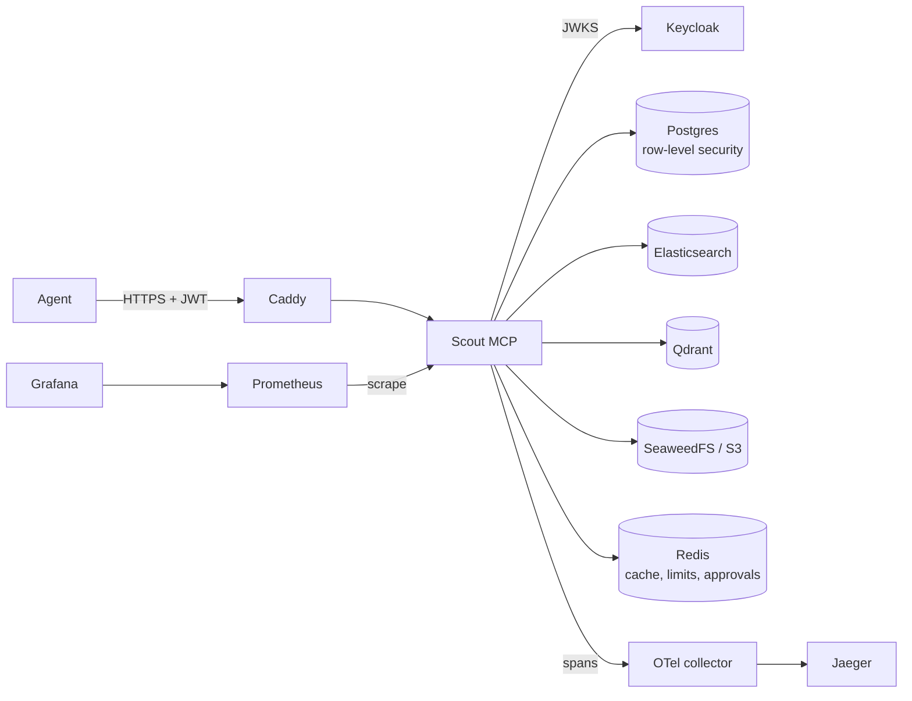

# Scout MCP

I built Scout MCP to see what it takes to put an MCP server in front of real company data and not regret it later. It is one server that gives AI agents controlled access to Postgres, Elasticsearch, a vector database and S3, plus a four-agent support copilot that uses it. Everything runs from one `docker compose up`.

[docs/ISSUES.md](docs/ISSUES.md) lists every defect I found and fixed while getting it to run, with the test that now guards each one.

## What it does

- **Authenticates every call.** Keycloak issues the tokens; the server checks signature, issuer, audience and expiry.
- **Keeps tenants apart in every store.** Postgres row-level security, Elasticsearch and Qdrant filters, S3 key prefixes, and the tenant in every cache key.
- **Denies by default.** Access comes from `config/policy.yaml`. No matching rule means no access, and a deny rule always wins.
- **Returns errors an agent can act on.** Every failure carries a code, whether to retry, and a hint.
- **Holds destructive calls for a human.** `s3.put_object` stays pending until a different identity approves that exact call. The approval works once.
- **Protects itself.** Rate limits per tenant and tool, a two-level cache, per-tool circuit breakers, retries with backoff, and a time budget per call.
- **Shows what happened.** One trace span and one audit line per call, Prometheus metrics, alert rules, and a Grafana dashboard.
- **Says what each tool returns, and holds it to that.** Every tool publishes an output schema, and a call whose result does not fit it fails with the tool's name.
- **Lets people in as well as agents.** People sign in with PKCE and carry their tenant and roles in the token. A reviewer needs the scope and the role, nobody approves a request they or their agent made, `GET /approvals?state=pending` lists what is waiting, and an optional signed webhook says a request arrived.
- **Takes tools, documents and tenants without editing the server.** `scout-mcp new-tool`, `scout-mcp ingest` and `scout-mcp tenant add`, and `scout-mcp policy test` checks every policy rule against a case file.
- **Works from a client's own model.** The `investigate-customer` prompt gives Claude Desktop, or any MCP client, the copilot's rules and only the tools that caller can see.

## Run it

You need Docker with Compose v2 and about 6 GB of free memory.

```bash
cp .env.example .env
docker compose up -d --build --wait          # builds the image, starts 12 services and a one-time bucket setup
docker compose --profile seed run --rm seed  # loads demo tickets and documents
```

Ask the copilot a question. It needs an OpenRouter key in `SCOUT_LLM_API_KEY`:

```bash
docker compose --profile copilot run --rm copilot \
  "Why was the refund on order o_9002 for CUST-1001 delayed?"
```

Or talk to the server yourself. Get a token for the `acme` tenant, then list the tools:

```bash
TOKEN=$(curl -s http://localhost:8081/realms/scout/protocol/openid-connect/token \
  -d grant_type=client_credentials -d client_id=copilot-acme \
  -d client_secret=dev-secret-copilot-acme | python3 -c 'import sys,json;print(json.load(sys.stdin)["access_token"])')

curl -sk https://localhost:8443/mcp \
  -H "Authorization: Bearer $TOKEN" \
  -H 'Content-Type: application/json' -H 'Accept: application/json, text/event-stream' \
  -d '{"jsonrpc":"2.0","id":1,"method":"tools/list"}'
```

`-k` skips TLS verification because Caddy signs with a local CA. To trust it instead: `docker compose cp caddy:/data/caddy/pki/authorities/local/root.crt ./caddy-root.crt`.

What is reachable from your machine, all on `127.0.0.1`:

| Port | Service | Why |
|------|---------|-----|
| 8443 | Caddy | The only way in to the MCP server. TLS, security headers, 1 MB body limit, only `/mcp`, `/approvals`, discovery and `/healthz` forwarded. |
| 8081 | Keycloak | Token endpoint. The admin console needs `127.0.0.1 keycloak` in `/etc/hosts` because the issuer is pinned to `keycloak:8080`. |
| 3000 | Grafana | Dashboard "Scout MCP" (`admin` / `admin`). |
| 9090 | Prometheus | Metrics and alert rules. |
| 16686 | Jaeger | Traces. |

Postgres, Redis, Elasticsearch, Qdrant and the S3 store (SeaweedFS) are on an internal network with no route to the host. Use `docker compose exec postgres psql -U scout_app scout` to look inside.

## How a call travels



Inside the server each call goes through validation, scope and policy checks, rate limiting, approval for destructive tools, the cache, and then the circuit breaker, retry and timeout around the tool. [docs/ARCHITECTURE.md](docs/ARCHITECTURE.md) walks through each step with the file it lives in.

## Numbers

Measured in CI on a shared 4-vCPU GitHub runner, three runs, through the TLS edge with real backends. The same row moves by up to about 40% between runs, so these are ranges. [docs/PERFORMANCE.md](docs/PERFORMANCE.md) has the full tables and the method.

| What | Result |
|------|--------|
| Cached tool call | 5 to 7 ms at p50 |
| `customer.build_context` (two Postgres queries, Elasticsearch, embedding, Qdrant) | 45 to 55 ms on a miss, 5 to 8 ms on a hit, 6.7 to 8.3x faster |
| `semantic_search` | 36 to 45 ms on a miss, 5 to 7 ms on a hit, 6.2 to 7.2x faster |
| 16 concurrent clients | 134 to 199 requests/s, no errors in any run |
| Whole stack memory | 2.2 to 2.3 GiB across 12 containers |
| Request overhead with the backend faked | 1.9 ms at p50, 2.1 to 2.5 ms at p95 (2.8 and 3.3 to 3.9 ms in the 0.3.0 numbers; the SDK, the code and the machine all changed since) |
| Output-schema check on every call | no measurable cost: p50 1.87 ms before, 1.86 ms after, one run each |
| `postgres.describe` through the edge, real Postgres, never cached | 5.0 ms at p50, 6.2 ms at p95 (one CI run, 200 calls) |
| Ingesting the same file twice | 1 chunk embedded the first time, 0 the second, in CI |
| Tests | 423 in-process, 43 end-to-end against the real stack (120 and 33 when I started the 0.5 work) |
| Container image | 1.06 GB, 0 fixable HIGH or CRITICAL vulnerabilities (was 4) |
| Python environment without PyTorch | 463 MB, down from 1.2 GB |

A cache hit costs about the same whatever the tool, because the floor is TLS, token verification and the MCP session. The cache saves the backend work, so it matters most for composed tools.

## Operate it

```bash
scout-mcp policy test --strict                    # config/policy_test.yaml against config/policy.yaml
scout-mcp policy check --subject role:support_copilot --tenant acme --action tool:s3:read --resource docs/a.txt
scout-mcp ingest --tenant acme docs/*.md          # chunk, embed and write documents for one tenant
scout-mcp tenant add initech                      # a tenant's three Keycloak clients; secrets shown once
scout-mcp new-tool weather.lookup                 # an installable plugin package that meets the tool contract
```

None of these edits `config/`. They print the rule, the allowlist entry or the next step, and a person makes the change.

## Develop without Docker

```bash
python3.11 -m venv mcpvenv
mcpvenv/bin/python -m pip install -e ".[dev]"
mcpvenv/bin/python -m pytest -q                  # about 4 s
mcpvenv/bin/python -m ruff check src tests deploy scripts
mcpvenv/bin/python scripts/bench_pipeline.py     # request overhead, backend faked
```

The tests run the real server, middleware, policy file and tool registry in one process, with Redis, the embedding model and token validation replaced. The end-to-end tests in `tests/e2e` need the running stack and skip themselves otherwise.

GitHub Actions runs four jobs on every push, and a credential scan of the commits on every pull request: the fast tests, static validation of the deploy files (`promtool`, `caddy validate`, `hadolint`), the full stack with 43 end-to-end tests, a sample ingest and the benchmark, and dependency and image scans.

## Before you put this in front of real data

The defaults are for development. At minimum:

- Change every password and secret in `.env`, the client secrets and the three users' passwords (`ana`, `rae` and `gus`, where `rae` can approve any pending call for acme) in `deploy/keycloak/scout-realm.json`, and the `scout_app`, `scout_ingest` and `keycloak` passwords in `deploy/sql/init.sql`.
- Run Keycloak with `start`, TLS and a real hostname instead of `start-dev`.
- Replace Caddy's `tls internal` with a real certificate.
- Set `SCOUT_ENV=production`. The server then refuses to start while any development credential, a plain-http issuer, or a disabled policy, tenant or approval check is still set.
- Free OpenRouter models route customer text to third-party hosts. Set `SCOUT_LLM_MODEL` to a model you are allowed to use, and `SCOUT_LLM_FALLBACK_MODEL=` empty to use only one.
- Redis is a single node. An outage makes every read a cache miss and each replica rate-limit on its own, but it stops approvals.

## Layout

```
src/scout_mcp/   server, auth, policy, tools (atomic, composed, workflow), reliability, cache, observability, agents
config/          policy.yaml, outbound HTTP allowlist
deploy/          compose support files: caddy, keycloak, postgres, prometheus, grafana, otel, seed
scripts/         benchmarks
tests/           unit and in-process tests; tests/e2e runs against the stack
docs/            ARCHITECTURE, DATA-MODEL, PERFORMANCE, ISSUES, PRD, AGENTS
MEMORY.md        working notes for whoever picks this up next
```

## License

MIT. See [LICENSE](LICENSE).
