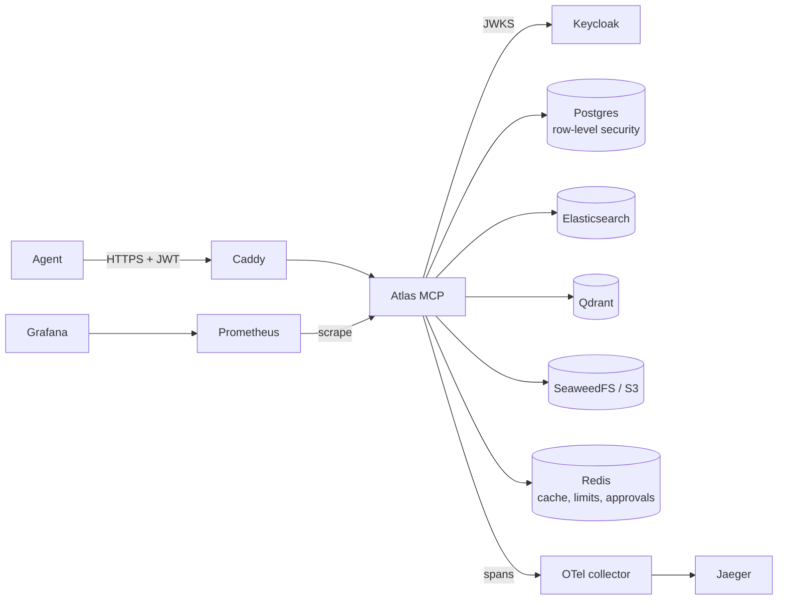

# Atlas MCP

I built Atlas MCP to see what it takes to put an MCP server in front of real company data and not regret it later. It is one server that gives AI agents controlled access to Postgres, Elasticsearch, a vector database and S3, plus a four-agent support copilot that uses it. Everything runs from one `docker compose up`.

I started from Fareed Khan's article [Building the 11 Layers of a Production-Grade MCP Server + Agentic System](https://levelup.gitconnected.com/building-the-11-layers-of-a-production-grade-mcp-server-agentic-system-de92127aca6f). It gave me the module layout and the twelve concerns. When I ran the code from the article, most of the request path did not work, so a large part of this repo is the fixing: [docs/ISSUES.md](docs/ISSUES.md) lists every defect I found and the test that now guards it.

## What it does

- **Authenticates every call.** Keycloak issues the tokens; the server checks signature, issuer, audience and expiry.
- **Keeps tenants apart in every store.** Postgres row-level security, Elasticsearch and Qdrant filters, S3 key prefixes, and the tenant in every cache key.
- **Denies by default.** Access comes from `config/policy.yaml`. No matching rule means no access, and a deny rule always wins.
- **Returns errors an agent can act on.** Every failure carries a code, whether to retry, and a hint.
- **Holds destructive calls for a human.** `s3.put_object` stays pending until a different identity approves that exact call. The approval works once.
- **Protects itself.** Rate limits per tenant and tool, a two-level cache, per-tool circuit breakers, retries with backoff, and a time budget per call.
- **Shows what happened.** One trace span and one audit line per call, Prometheus metrics, alert rules, and a Grafana dashboard.

## Run it

You need Docker with Compose v2 and about 6 GB of free memory.

```bash
cp .env.example .env
docker compose up -d --build --wait          # builds the image, starts 14 services
docker compose --profile seed run --rm seed  # loads demo tickets and documents
```

Ask the copilot a question. It needs an OpenRouter key in `ATLAS_LLM_API_KEY`:

```bash
docker compose --profile copilot run --rm copilot \
  "Why was the refund on order o_9002 for CUST-1001 delayed?"
```

Or talk to the server yourself. Get a token for the `acme` tenant, then list the tools:

```bash
TOKEN=$(curl -s http://localhost:8081/realms/atlas/protocol/openid-connect/token \
  -d grant_type=client_credentials -d client_id=copilot-acme \
  -d client_secret=dev-secret-copilot-acme | python3 -c 'import sys,json;print(json.load(sys.stdin)["access_token"])')

curl -sk https://localhost:8443/mcp \
  -H "Authorization: Bearer $TOKEN" \
  -H 'Content-Type: application/json' -H 'Accept: application/json, text/event-stream' \
  -d '{"jsonrpc":"2.0","id":1,"method":"tools/list"}'
```

`-k` skips TLS verification because Caddy signs with a local CA. To trust it instead: `docker compose cp caddy:/data/caddy/pki/authorities/local/root.crt ./caddy-root.crt`.

What is reachable from your machine, all on `127.0.0.1`:

| Port | Service | Why |
|------|---------|-----|
| 8443 | Caddy | The only way in to the MCP server. TLS, security headers, 1 MB body limit, only `/mcp`, `/approvals`, discovery and `/healthz` forwarded. |
| 8081 | Keycloak | Token endpoint. The admin console needs `127.0.0.1 keycloak` in `/etc/hosts` because the issuer is pinned to `keycloak:8080`. |
| 3000 | Grafana | Dashboard "Atlas MCP" (`admin` / `admin`). |
| 9090 | Prometheus | Metrics and alert rules. |
| 16686 | Jaeger | Traces. |

Postgres, Redis, Elasticsearch, Qdrant and the S3 store (SeaweedFS) are on an internal network with no route to the host. Use `docker compose exec postgres psql -U atlas_app atlas` to look inside.

## How a call travels



Inside the server each call goes through validation, scope and policy checks, rate limiting, approval for destructive tools, the cache, and then the circuit breaker, retry and timeout around the tool. [docs/ARCHITECTURE.md](docs/ARCHITECTURE.md) walks through each step with the file it lives in.

## Numbers

<!-- NUMBERS -->

## Develop without Docker

```bash
python3.11 -m venv mcpvenv
mcpvenv/bin/python -m pip install -e ".[dev]"
mcpvenv/bin/python -m pytest -q                  # about 4 s
mcpvenv/bin/python -m ruff check src tests deploy scripts
mcpvenv/bin/python scripts/bench_pipeline.py     # request overhead, backend faked
```

The tests run the real server, middleware, policy file and tool registry in one process, with Redis, the embedding model and token validation replaced. The end-to-end tests in `tests/e2e` need the running stack and skip themselves otherwise.

GitHub Actions runs four jobs on every push: the fast tests, static validation of the deploy files (`promtool`, `caddy validate`, `hadolint`), the full stack with 29 end-to-end tests and the benchmark, and dependency and image scans.

## Before you put this in front of real data

The defaults are for development. At minimum:

- Change every password and secret in `.env`, the client secrets in `deploy/keycloak/atlas-realm.json`, and the `atlas_app` and `keycloak` passwords in `deploy/sql/init.sql`.
- Run Keycloak with `start`, TLS and a real hostname instead of `start-dev`.
- Replace Caddy's `tls internal` with a real certificate.
- Decide which LLM providers may see customer text. `ATLAS_LLM_FALLBACK` is off by default.
- Redis is a single node, so an outage stops rate limiting, caching and approvals.

[docs/ISSUES.md](docs/ISSUES.md) lists what I know is still open.

## Layout

```
src/atlas_mcp/   server, auth, policy, tools (atomic, composed, workflow), reliability, cache, observability, agents
config/          policy.yaml, outbound HTTP allowlist
deploy/          compose support files: caddy, keycloak, postgres, prometheus, grafana, otel, seed
scripts/         benchmarks
tests/           unit and in-process tests; tests/e2e runs against the stack
docs/            ARCHITECTURE, DATA-MODEL, PERFORMANCE, ISSUES, PRD, AGENTS
MEMORY.md        working notes for whoever picks this up next
```

## License

MIT. See [LICENSE](LICENSE).
