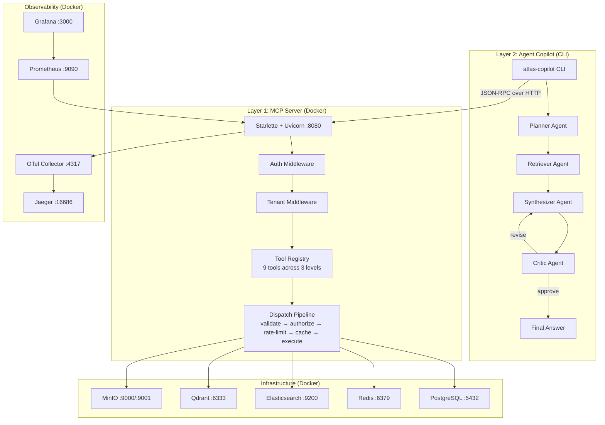

# Atlas MCP — Complete End-to-End Startup Guide

> [!NOTE]
> This guide walks you through **everything** needed to start the system, ask questions to the agents, and watch them work.

---

## 1. Architecture Overview (What You're Starting)

The system has **two main layers**:



**The four-agent pipeline:**

| Agent | Role | Input → Output |
|-------|------|----------------|
| **Planner** | Decomposes question into retrieval needs | Question → `Plan` (JSON with needs + priorities) |
| **Retriever** | Calls MCP tools to fetch data | Plan → `RetrievalResult` (findings from DB/search) |
| **Synthesizer** | Drafts a customer reply with citations | Findings → `Draft` (text with `[S1]`, `[S2]` refs) |
| **Critic** | Quality gate — approve or request revision | Draft → `Verdict` (approve/revise + issues) |

---

## 2. Prerequisites

| Requirement | How to Check | Install If Missing |
|-------------|-------------|-------------------|
| **Docker Desktop** | `docker --version` | [docker.com/products/docker-desktop](https://www.docker.com/products/docker-desktop/) |
| **Docker Compose** | `docker compose version` | Bundled with Docker Desktop |
| **Python 3.11+** | `python3 --version` | `brew install python@3.11` |
| **pip** | `pip3 --version` | Comes with Python |
| **~8 GB free RAM** | — | Elasticsearch alone needs 512MB+ |
| **~10 GB disk** | — | Docker images (ES, Postgres, etc.) |


---

## 3. Step-by-Step Startup

### Step 1: Configure Your `.env` File

Your [.env](file:///Users/yashhmahajan/Desktop/production-grade-agentic-mcp-system/.env) is already configured. The critical variables are:

```bash
# ── LLM (powers the 4 agents) ───────────────────────────────────
ATLAS_LLM_API_KEY=sk-or-v1-...        # Your OpenRouter key (already set)
ATLAS_LLM_MODEL=deepseek/deepseek-v4-flash:free  # Free model

# ── Agent CLI needs these ────────────────────────────────────────
ATLAS_MCP_URL=http://localhost:8080    # Where the MCP server will be
ATLAS_MCP_TOKEN=dev-token-change-me    # Bearer token for auth
ATLAS_TENANT=acme                      # Tenant to query (seed data has "acme" and "globex")
```

---

### Step 2: Start the Full Infrastructure Stack

```bash
cd /Users/yashhmahajan/Desktop/production-grade-agentic-mcp-system
docker compose up -d
```

This starts **10 services**:

| Service | Container | Port | Status Check |
|---------|-----------|------|-------------|
| **Atlas MCP Server** | `atlas-mcp` | `:8080` | `curl http://localhost:8080/healthz` |
| **PostgreSQL 16** | `postgres` | `:5432` | Healthcheck built-in |
| **Redis 7** | `redis` | `:6379` | Healthcheck built-in |
| **Elasticsearch 8** | `elasticsearch` | `:9200` | Healthcheck built-in |
| **Qdrant** | `qdrant` | `:6333` | `curl http://localhost:6333` |
| **MinIO (S3)** | `minio` | `:9000`/`:9001` | Console at `:9001` |
| **OTel Collector** | `otel-collector` | `:4317` | — |
| **Jaeger** | `jaeger` | `:16686` | UI in browser |
| **Prometheus** | `prometheus` | `:9090` | UI in browser |
| **Grafana** | `grafana` | `:3000` | `admin` / `admin` |

**Wait for everything to be healthy** (~30-60 seconds):

```bash
docker compose ps
```

You want to see all services as `running` (with `healthy` for postgres, redis, elasticsearch).

> [!TIP]
> If `atlas-mcp` keeps restarting, check logs with `docker compose logs atlas-mcp -f`. It depends on postgres, redis, and elasticsearch being healthy first.

---

### Step 3: Verify the MCP Server Is Running

Run these checks:

```bash
# Health check
curl http://localhost:8080/healthz
# Expected: {"status":"ok"}

# Readiness check
curl http://localhost:8080/readyz
# Expected: {"status":"ready"}

# Discovery endpoint — see all available tools
curl http://localhost:8080/.well-known/mcp-server | python3 -m json.tool
```

The discovery endpoint will show you the **9 registered tools**:

| Level | Tool Name | Description |
|-------|-----------|-------------|
| **Atomic** | `postgres.query` | Run read-only SQL on tenant-scoped Postgres |
| **Atomic** | `elasticsearch.search` | Full-text search across documents |
| **Atomic** | `vector.search` | Vector similarity search via Qdrant |
| **Atomic** | `s3.get` | Read objects from MinIO/S3 |
| **Atomic** | `s3.put` | Write objects (destructive — needs approval) |
| **Atomic** | `http.fetch` | Fetch external URLs (allowlisted) |
| **Composed** | `semantic_search` | Embed query → vector search → return results |
| **Composed** | `hybrid_search` | Elasticsearch + vector search combined |
| **Workflow** | `customer.build_context` | Fan-out: orders + tickets + docs for a customer |

---

### Step 4: Install the Python CLI (for Asking Questions)

```bash
cd /Users/yashhmahajan/Desktop/production-grade-agentic-mcp-system

# Option A: Use the existing virtual environment
source mcpvenv/bin/activate
pip install -e .

# Option B: Create a fresh virtual environment
python3 -m venv venv
source venv/bin/activate
pip install -e .
```

This installs two CLI commands:
- **`atlas-mcp`** — Starts the MCP server (already running in Docker)
- **`atlas-copilot`** — The agent CLI to ask questions

---

### Step 5: Ask Questions via the CLI

```bash
# Make sure env vars are loaded
export ATLAS_MCP_URL=http://localhost:8080
export ATLAS_MCP_TOKEN=dev-token-change-me
export ATLAS_TENANT=acme
export ATLAS_LLM_API_KEY=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
export ATLAS_LLM_MODEL=deepseek/deepseek-v4-flash:free

# Ask a question using seed data
atlas-copilot "Why was the refund on order o_9002 for CUST-1001 delayed?"
```

**Alternative questions you can try** (using the seed data in [init.sql](file:///Users/yashhmahajan/Desktop/production-grade-agentic-mcp-system/deploy/sql/init.sql)):

```bash
atlas-copilot "What is the status of order o_9003 for CUST-1002?"
atlas-copilot "Show me the refund policy for CUST-1001"
atlas-copilot "What orders does CUST-1001 have?"
atlas-copilot "When will order o_9001 be delivered for CUST-1001?"
```

> [!NOTE]
> The seed data has two tenants: **`acme`** (customers CUST-1001, CUST-1002) and **`globex`** (customer CUST-2001). The `ATLAS_TENANT=acme` setting means you can only see acme's data (Row-Level Security enforced at the DB level).

---

## 4. What You'll See When Agents Run

### CLI Output

When you run `atlas-copilot`, you'll see output like this:

```
========================================================================
DRAFT REPLY (approved)
========================================================================
Based on the order records [S1], order o_9002 for CUST-1001 (Alicia Rivera)
is currently in "refund_pending" status with a value of $49.00. According
to our refund policy [S2], refunds are issued within 5 business days of
receiving the returned item. The refund appears to still be processing.
A human agent should verify whether the return has been received before
confirming the timeline.

========================================================================
TRACE SUMMARY
========================================================================
{
  "draft": "...",
  "approved": true,
  "citations": ["[S1]", "[S2]"],
  "run_id": "a1b2c3d4...",
  "tokens_in": 1847,
  "tokens_out": 312,
  "tool_calls": 3,
  "plan": {
    "customer_id": "1001",
    "needs": [
      {"id": "n1", "description": "order status and refund details", "priority": 1},
      {"id": "n2", "description": "refund policy", "priority": 2}
    ]
  },
  "retrieval": {
    "iterations_used": 3,
    "exceeded_budget": false,
    "findings_count": 2
  },
  "critic": {
    "approved": true,
    "issues": [],
    "revision_hints": null
  }
}
```

### The Agent Pipeline in Detail

```
┌─────────────────────────────────────────────────────────────────────┐
│  1. PLANNER                                                         │
│  Input: "Why was the refund on order o_9002 for CUST-1001 delayed?"│
│  Output: {needs: ["order status", "refund policy"], customer_id: "1001"} │
├─────────────────────────────────────────────────────────────────────┤
│  2. RETRIEVER (bounded loop, max 6 iterations)                      │
│  Iteration 1: calls customer.build_context(customer_id="CUST-1001")│
│  Iteration 2: calls postgres.query("SELECT * FROM orders WHERE...") │
│  Iteration 3: calls semantic_search("refund policy")               │
│  → Emits {done: true, findings: [...]}                              │
├─────────────────────────────────────────────────────────────────────┤
│  3. SYNTHESIZER                                                     │
│  Input: question + findings                                         │
│  Output: Draft with [S1], [S2] citations                            │
├─────────────────────────────────────────────────────────────────────┤
│  4. CRITIC                                                          │
│  Checks: facts supported? no false promises? under 200 words?       │
│  Verdict: "approve" → return | "revise" → back to synthesizer (1x) │
└─────────────────────────────────────────────────────────────────────┘
```

---

## 5. Watching the Agents Work (Observability)

### 🔭 Jaeger — Distributed Traces
**URL: [http://localhost:16686](http://localhost:16686)**

1. Open Jaeger in your browser
2. In the "Service" dropdown, select `atlas-mcp`
3. Click "Find Traces"
4. Each trace shows the full request pipeline: auth → tenant → rate-limit → cache → tool execution
5. The `run_id` from the CLI output maps to a trace

### 📈 Grafana — Metrics Dashboards
**URL: [http://localhost:3000](http://localhost:3000)** (login: `admin` / `admin`)

1. Add Prometheus as a data source: `http://prometheus:9090`
2. You can explore metrics like:
   - `atlas_tool_calls_total` — total tool invocations by tool name
   - `atlas_tool_latency_seconds` — execution time histograms
   - `atlas_cache_hits_total` — cache hit rate

### 📊 Prometheus — Raw Metrics
**URL: [http://localhost:9090](http://localhost:9090)**

```
# Query examples
atlas_tool_calls_total
atlas_tool_latency_seconds_bucket
rate(atlas_tool_calls_total[5m])
```

### 🗄️ MinIO Console — Object Storage
**URL: [http://localhost:9001](http://localhost:9001)** (login: `minioadmin` / `minioadmin`)

### 📋 Server Logs (Real-time)

```bash
# Follow the MCP server logs
docker compose logs atlas-mcp -f

# Follow ALL service logs
docker compose logs -f

# View only errors
docker compose logs atlas-mcp -f 2>&1 | grep -i error
```

---

## 6. Connecting from Claude Desktop or Cursor

Add this to your MCP host configuration:

**Claude Desktop** (`~/Library/Application Support/Claude/claude_desktop_config.json`):

```json
{
  "mcpServers": {
    "atlas-mcp": {
      "type": "http",
      "url": "http://localhost:8080/mcp",
      "headers": {
        "Authorization": "Bearer dev-token-change-me",
        "X-Tenant-Id": "acme"
      }
    }
  }
}
```

**Cursor** (`.cursor/mcp.json` in your project root):

```json
{
  "mcpServers": {
    "atlas-mcp": {
      "type": "http",
      "url": "http://localhost:8080/mcp",
      "headers": {
        "Authorization": "Bearer dev-token-change-me",
        "X-Tenant-Id": "acme"
      }
    }
  }
}
```

> [!IMPORTANT]
> The auth middleware will reject requests without a valid Bearer token. For local dev, the server accepts the `dev-token-change-me` string. In production, this would be a real JWT from your OAuth provider.

---

## 7. Running Tests

```bash
cd /Users/yashhmahajan/Desktop/production-grade-agentic-mcp-system
source mcpvenv/bin/activate  # or your venv
pip install -e ".[dev]"
pytest -v
```

This runs 3 test suites:
- [test_circuit_breaker.py](file:///Users/yashhmahajan/Desktop/production-grade-agentic-mcp-system/tests/test_circuit_breaker.py) — Reliability state machine
- [test_errors.py](file:///Users/yashhmahajan/Desktop/production-grade-agentic-mcp-system/tests/test_errors.py) — SERF error format stability
- [test_policy.py](file:///Users/yashhmahajan/Desktop/production-grade-agentic-mcp-system/tests/test_policy.py) — Authorization deny-by-default

---

## 8. Troubleshooting

### Common Issues

| Problem | Cause | Fix |
|---------|-------|-----|
| `atlas-mcp` keeps restarting | Infra services not healthy yet | `docker compose up -d && sleep 60 && docker compose ps` |
| `401 Unauthorized` from CLI | Missing/wrong `ATLAS_MCP_TOKEN` | `export ATLAS_MCP_TOKEN=dev-token-change-me` |
| `ConnectionRefusedError` | MCP server not running | `docker compose up -d` and check `docker compose ps` |
| LLM calls timeout | Free model rate limits | Wait and retry, or switch to a paid model |
| `No models configured` error | `ATLAS_LLM_API_KEY` not set | `export ATLAS_LLM_API_KEY=sk-or-v1-...` |
| Elasticsearch OOM | Not enough Docker memory | Increase Docker Desktop memory to 8GB+ |
| `pip install -e .` fails | Wrong Python version | Use Python 3.11+: `python3.11 -m venv venv` |

### Check Individual Service Health

```bash
# PostgreSQL
docker compose exec postgres pg_isready -U atlas

# Redis
docker compose exec redis redis-cli ping

# Elasticsearch
curl http://localhost:9200/_cluster/health

# Qdrant
curl http://localhost:6333/collections

# MinIO
curl http://localhost:9000/minio/health/live
```

### Rebuild After Code Changes

```bash
docker compose build atlas-mcp
docker compose up -d atlas-mcp
```

---

## 9. Quick Reference — Complete Startup Sequence

```bash
# 1. Navigate to project
cd /Users/yashhmahajan/Desktop/production-grade-agentic-mcp-system

# 2. Start all infrastructure
docker compose up -d

# 3. Wait for services (check health)
docker compose ps

# 4. Verify MCP server
curl http://localhost:8080/healthz

# 5. Install CLI
source mcpvenv/bin/activate
pip install -e .

# 6. Set environment variables
export ATLAS_MCP_URL=http://localhost:8080
export ATLAS_MCP_TOKEN=dev-token-change-me
export ATLAS_TENANT=acme
export ATLAS_LLM_API_KEY=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
export ATLAS_LLM_MODEL=deepseek/deepseek-v4-flash:free

# 7. Ask a question!
atlas-copilot "Why was the refund on order o_9002 for CUST-1001 delayed?"

# 8. Watch the traces
open http://localhost:16686   # Jaeger
open http://localhost:3000    # Grafana (admin/admin)
open http://localhost:9001    # MinIO Console (minioadmin/minioadmin)
```

---

## 10. Stopping Everything

```bash
# Stop all services (data preserved in volumes)
docker compose down

# Stop and DELETE all data (clean slate)
docker compose down -v
```

---

## 11. Key Files Reference

| File | Purpose |
|------|---------|
| [docker-compose.yml](file:///Users/yashhmahajan/Desktop/production-grade-agentic-mcp-system/docker-compose.yml) | Full stack definition (10 services) |
| [.env](file:///Users/yashhmahajan/Desktop/production-grade-agentic-mcp-system/.env) | All configuration variables |
| [server.py](file:///Users/yashhmahajan/Desktop/production-grade-agentic-mcp-system/src/atlas_mcp/server.py) | MCP server entry point + dispatch pipeline |
| [cli.py](file:///Users/yashhmahajan/Desktop/production-grade-agentic-mcp-system/src/atlas_mcp/agents/cli.py) | `atlas-copilot` CLI entry point |
| [orchestrator.py](file:///Users/yashhmahajan/Desktop/production-grade-agentic-mcp-system/src/atlas_mcp/agents/orchestrator.py) | Four-agent pipeline wiring |
| [base.py](file:///Users/yashhmahajan/Desktop/production-grade-agentic-mcp-system/src/atlas_mcp/agents/base.py) | LLM client with fallback chain |
| [init.sql](file:///Users/yashhmahajan/Desktop/production-grade-agentic-mcp-system/deploy/sql/init.sql) | Database schema + seed data |
| [policy.yaml](file:///Users/yashhmahajan/Desktop/production-grade-agentic-mcp-system/config/policy.yaml) | RBAC/ABAC authorization rules |
| [prompts.py](file:///Users/yashhmahajan/Desktop/production-grade-agentic-mcp-system/src/atlas_mcp/agents/prompts.py) | All agent system prompts |
